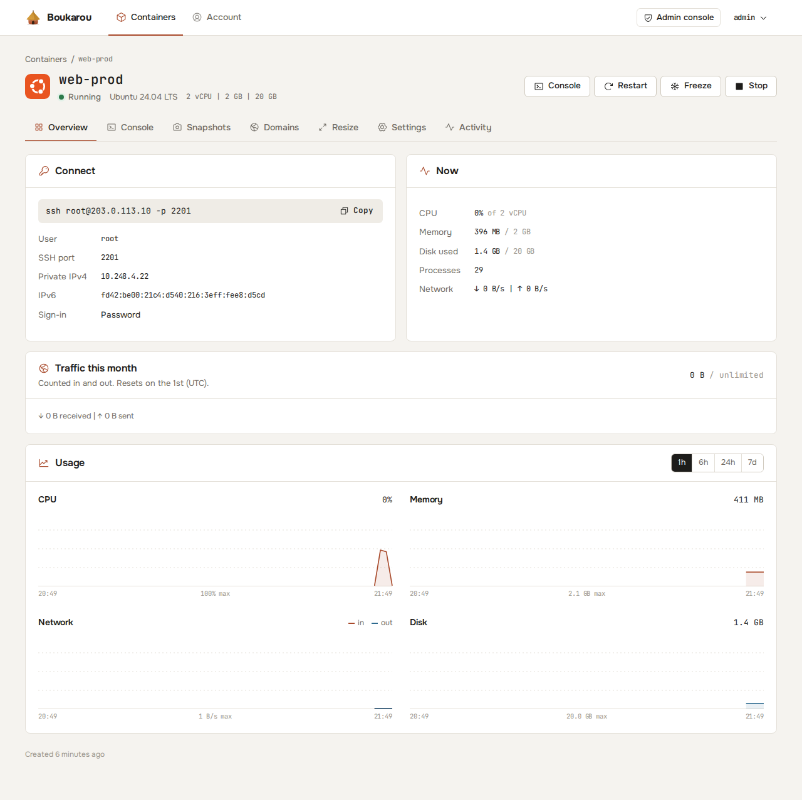
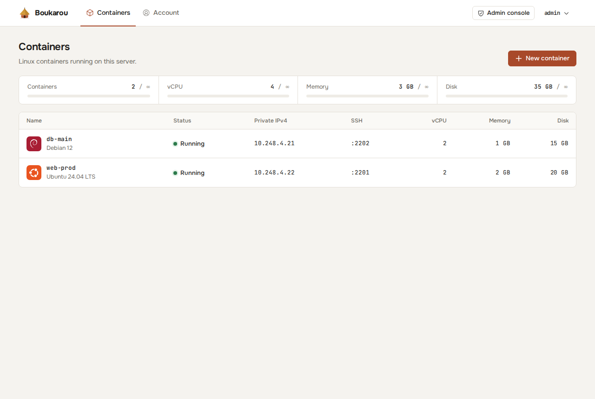
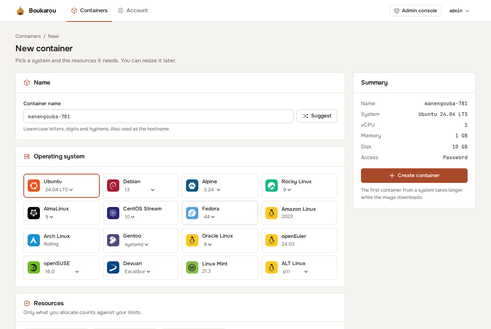
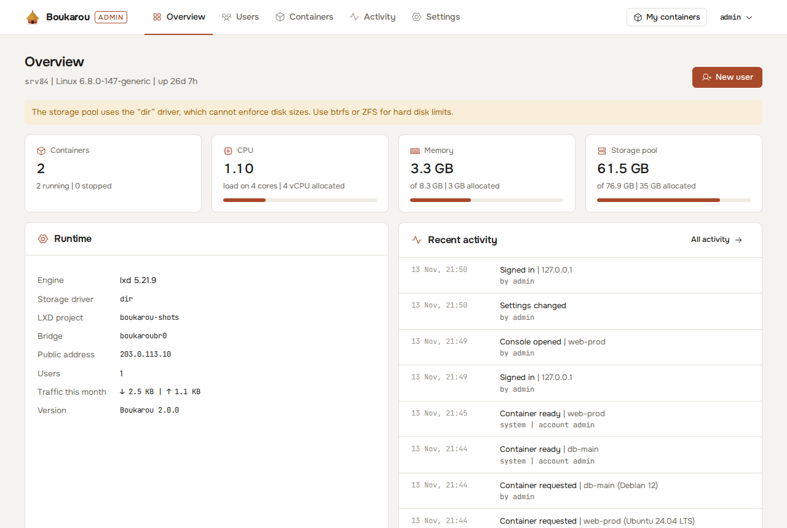
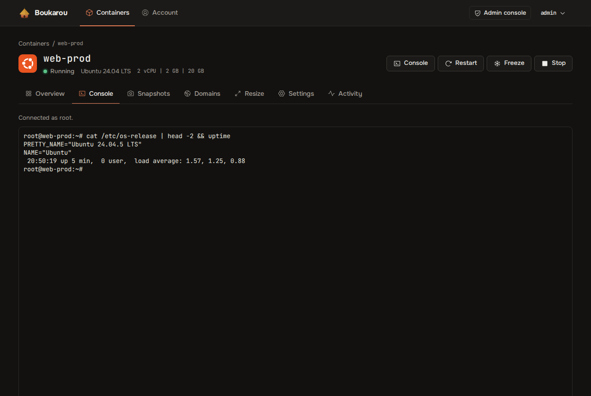

<p align="center"></p>

# Boukarou

**A free, self-hosted control panel for Linux containers.** Install it on your own server, create accounts for the people you trust, give each one the limits you want, and let them run their own containers: SSH access, a root console in the browser, snapshots, metrics and custom domains with HTTPS.

Boukarou is the open-source edition of [KmerHosting LXC](https://lxc.kmerhosting.com). It has the same container features, with no billing: everything is free and unlimited, except for the limits you set.

> A *boukarou* is the round hut of Cameroon's villages: small, sturdy and self-contained, like a container.



## Features

**For users**
- Create containers from more than 30 systems: Ubuntu, Debian, Alpine, Rocky, AlmaLinux, CentOS Stream, Fedora, Arch, openSUSE and more.
- Pick the vCPU, memory and disk for each container, and resize later. CPU and memory change live.
- SSH on a dedicated port per container, with a generated root password and an optional SSH key.
- Root terminal in the browser.
- Start, stop, restart, freeze and unfreeze, reinstall to a fresh system, and delete.
- Snapshots: take, restore, delete.
- CPU, memory, network and disk charts, plus monthly traffic.
- Custom domains: point a domain at the server and get HTTPS through Let's Encrypt.
- Two-factor sign-in (TOTP), English and French, light and dark themes.



**For the administrator** (`/admin`)
- Create users with a username and a temporary password. Users choose their own password at first sign-in.
- Per-user limits, each one optional: containers, total vCPU, memory and disk, snapshots per container, monthly traffic per container, domains.
- Containers that go over their monthly traffic are slowed to 1 kbit/s until the 1st of the next month.
- See and manage every container, follow the activity log, and choose which systems users can install.
- Host health: CPU load, memory and storage pool usage.



## Install

You need a fresh **Ubuntu 22.04, 24.04 or 26.04** server: a KVM VPS or a dedicated machine. It cannot be an LXC/OpenVZ container itself. Run as root:

```bash
curl -fsSL https://raw.githubusercontent.com/KmerHosting/boukarou/main/deploy/install.sh | sudo bash
```

The installer:
- installs Node.js, LXD, nginx and certbot;
- creates a btrfs storage pool so disk limits are enforced;
- starts the panel on port **1974**;
- prints the administrator's username and generated password, **once**.

Then open `http://SERVER_IP:1974/admin`.

To serve the panel itself on a domain with HTTPS, create the DNS record first, then run:

```bash
curl -fsSL https://raw.githubusercontent.com/KmerHosting/boukarou/main/deploy/install.sh | sudo BOUKAROU_DOMAIN=panel.example.com BOUKAROU_EMAIL=you@example.com bash
```

### Installer options

| Variable | Default | Meaning |
| --- | --- | --- |
| `BOUKAROU_PORT` | `1974` | Panel port |
| `BOUKAROU_DOMAIN` | none | Serve the panel on this domain with HTTPS |
| `BOUKAROU_EMAIL` | none | Let's Encrypt contact |
| `BOUKAROU_POOL_SIZE` | 60% of free disk | Size of the btrfs pool, for example `200GB`. Only used when LXD is set up for the first time |
| `BOUKAROU_NO_DOMAINS` | none | Skip nginx and certbot. Custom domains stay off |

### Ports to open

| Port | Use |
| --- | --- |
| `1974/tcp` | The panel (not needed when it is served on a domain) |
| `2200–2999/tcp` | SSH into containers, one port each. The range can be changed in Settings |
| `80/tcp`, `443/tcp` | Custom domains and certificates |

When UFW is active, the installer opens these ports for you. If your cloud provider has its own firewall, open them there too.

## Administration

The administrator password can only be changed on the server:

```bash
sudo boukarou reset-admin-password            # prints a new random password
sudo boukarou reset-admin-password --prompt   # type your own
```

Other commands:

```bash
sudo boukarou doctor                    # check LXD, the service, storage, nginx
sudo boukarou reset-password <user>     # new temporary password for a user
sudo boukarou users                     # list accounts
sudo boukarou set-public-host <ip|host> # address shown in SSH commands
sudo boukarou update                    # pull the latest version and restart
sudo boukarou logs                      # follow the logs
sudo boukarou uninstall                 # remove the panel (containers are kept)
```

The administrator can also reset a user's password or two-factor sign-in from **Admin → Users**.



## How it works

- **One process.** An Express server holds the API, the web app and the terminal WebSocket. It runs as the `boukarou` systemd service.
- **SQLite** (`node:sqlite`) stores accounts, sessions, containers, metrics and activity in `/var/lib/boukarou/panel.db`. No external database is needed.
- **LXD** runs the containers in a dedicated project (`boukarou`) on a dedicated bridge (`boukaroubr0`), apart from anything else on the host.
  - Each container gets a fixed private IPv4 address.
  - Its SSH port is forwarded with an LXD proxy device.
- **The browser terminal** connects straight to LXD's interactive exec API over the local socket.
- **Metrics** are sampled every minute and kept for 7 days. Traffic is counted per calendar month.
- **Custom domains** each get an nginx site (`boukarou-domain-*.conf`) and a Let's Encrypt certificate, issued with the webroot method.



## Security notes

- The panel has full control over LXD on the host. Only create accounts for people you trust with a Linux root shell.
- Passwords are hashed with scrypt. Sign-in is rate-limited, sessions are kept server-side and can be revoked, and two-factor sign-in is available.
- Every request that changes something must carry a custom header, which blocks cross-site form attacks. The terminal only accepts connections from the panel's own page.
- For use over the Internet, serve the panel over HTTPS (`BOUKAROU_DOMAIN`).

## Development

```bash
npm install
npm run dev          # API on :1974; uses ./data and the local LXD
npm run dev:web      # Vite on :5174, proxies /api
npm run check        # syntax + type checks
npm test
npm run i18n         # list untranslated French strings
```

Environment variables (all optional): `PORT`, `HOST`, `BOUKAROU_DATA_DIR`, `BOUKAROU_PROJECT`, `BOUKAROU_NETWORK`, `BOUKAROU_POOL`, `BOUKAROU_MANAGE_UFW=false`, `BOUKAROU_RESERVED_DOMAINS`.

## License

[MIT](LICENSE) © 2026 KmerHosting LLC
